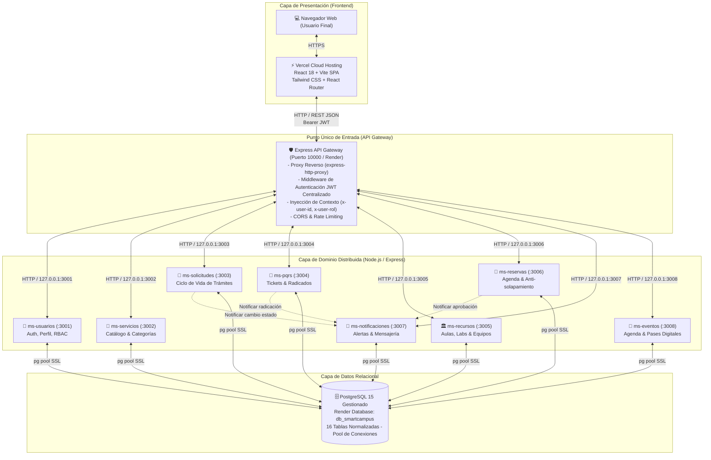
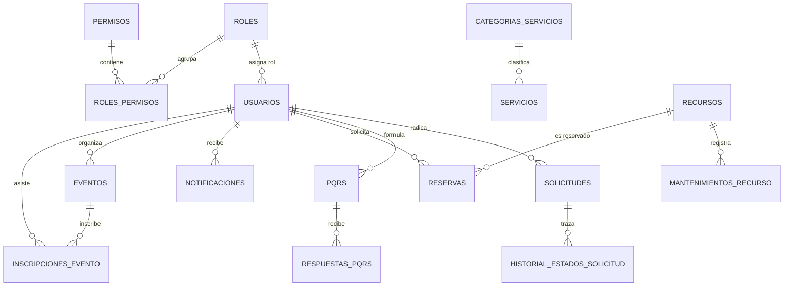

# 🏛️ PROYECTO INTEGRADOR: UAJS SMART CAMPUS
## DOCUMENTACIÓN MAESTRA CONSOLIDADA — ENTREGA FINAL
### Plataforma Distribuida para la Gestión y Articulación de Servicios Universitarios

---

**Institución:** Corporación Universitaria Antonio José de Sucre (UNIAJS)  
**Facultad:** Facultad de Ingenierías  
**Programa Académico:** Ingeniería de Sistemas  
**Asignatura:** Sistemas Distribuidos (Ciclo 2026)  
**Docente:** Mag. Laura Patricia Paternina Álvarez  
**Fecha de Entrega:** Noviembre de 2026  

---

### 👥 Equipo de Trabajo e Integrantes

| Nombre Completo | Identificación / Código | Rol en el Proyecto | Correo Institucional |
| :--- | :--- | :--- | :--- |
| **Wadith Rivas** | *(Líder de Proyecto)* | Arquitecto de Software & DevOps | `wrivas@uajs.edu.co` |
| **Edimer Paternina** | *(Desarrollador Core)* | Especialista Frontend & UI/UX | `epaternina@uajs.edu.co` |
| **Job David Pérez Guzmán** | *(Desarrollador Core)* | Líder Backend & Microservicios | `jobperez@uajs.edu.co` |
| **Flor Florez** | *(Desarrollador Core)* | Administradora de BD & QA | `fflorez@uajs.edu.co` |

---

### 🌐 Enlaces Oficiales del Proyecto en Producción

- **Frontend en la Nube (Vercel):** [https://uajs-smart-campus.vercel.app](https://uajs-smart-campus.vercel.app)
- **Backend & API Gateway en la Nube (Render):** [https://uajs-smart-campus-backend.onrender.com](https://uajs-smart-campus-backend.onrender.com)
- **Repositorio Oficial en GitHub:** [https://github.com/WRivxs/UAJS-Smart-Campus](https://github.com/WRivxs/UAJS-Smart-Campus)
- **Base de Datos Gestionada:** PostgreSQL 15 en Render (`uajs-smart-campus-db`)

---

## 📑 Tabla de Contenido General

1. [Resumen Ejecutivo y Contexto Institucional](#1-resumen-ejecutivo-y-contexto-institucional)
2. [Situación Problemática, Problema y Justificación](#2-situación-problemática-problema-y-justificación)
3. [Objetivos del Proyecto (General y Específicos)](#3-objetivos-del-proyecto-general-y-específicos)
4. [Arquitectura del Sistema Distribuido](#4-arquitectura-del-sistema-distribuido)
5. [Especificación del Frontend en React](#5-especificación-del-frontend-en-react)
6. [Especificación del Backend y Microservicios](#6-especificación-del-backend-y-microservicios)
7. [Modelo de Datos y Persistencia (PostgreSQL)](#7-modelo-de-datos-y-persistencia-postgresql)
8. [Seguridad y Control de Acceso Basado en Roles (RBAC)](#8-seguridad-y-control-de-acceso-basado-en-roles-rbac)
9. [Despliegue e Infraestructura (Nube y Local)](#9-despliegue-e-infraestructura-nube-y-local)
10. [Matriz de Pruebas y Evidencias de Ejecución](#10-matriz-de-pruebas-y-evidencias-de-ejecución)
11. [Galería de Evidencias y Capturas de Pantalla](#11-galería-de-evidencias-y-capturas-de-pantalla)
12. [Conclusiones y Trabajo Futuro](#12-conclusiones-y-trabajo-futuro)

---

## 1. Resumen Ejecutivo y Contexto Institucional

La **Corporación Universitaria Antonio José de Sucre (UNIAJS)** cuenta con una variedad de servicios digitales e iniciativas orientadas a facilitar los trámites académicos, la gestión de infraestructura y los requerimientos administrativos de sus estudiantes, profesores y funcionarios. Históricamente, la dispersión de dichos servicios en canales heterogéneos o manuales genera fricción operativa y dificulta la trazabilidad de las solicitudes.

A partir de este escenario, se concibe y desarrolla **UAJS Smart Campus**, una plataforma web concebida como un **sistema distribuido de servicios universitarios**, cuyo propósito central es integrar y facilitar el acceso a diferentes funcionalidades institucionales desde una interfaz moderna, responsiva y unificada.

El proyecto experimentó una evolución técnica guiada por los principios de la asignatura de **Sistemas Distribuidos**:
- **Fase Inicial:** Planteamiento como una aplicación web estructurada bajo el patrón Modelo-Vista-Controlador (MVC).
- **Fase Distribuida (Fase Actual):** Evolución hacia una **arquitectura basada en microservicios independientes desacoplados**, comunicados mediante una **API REST síncrona** y un componente unificador denominado **API Gateway**, respaldados por una capa de persistencia relacional en **PostgreSQL**.

> ⚠️ **Alcance y Naturaleza de la Propuesta:** La plataforma no pretende sustituir los sistemas de información institucionales existentes (ERP, sistemas de notas nucleares). Su propósito académico es desarrollar un prototipo funcional avanzado de integración y gestión de servicios universitarios, plenamente preparado para interoperar a futuro mediante APIs y estándares abiertos.

---

## 2. Situación Problemática, Problema y Justificación

### 2.1 Situación Problemática
En la cotidianidad de la UNIAJS convergen actores con necesidades y permisos heterogéneos:
- **Estudiantes:** Requieren radicar certificados, apartar salas de cómputo o laboratorios, consultar la agenda de eventos académicos, revisar notificaciones institucionales y formular PQRS.
- **Docentes:** Precisan apartar espacios especializados, gestionar recursos para docencia e investigación y revisar el estado de sus requerimientos.
- **Personal Administrativo:** Administra la carga de trabajo, tramita las solicitudes, audita el inventario físico y da respuesta formal a los tickets de PQRS.
- **Administradores del Sistema:** Supervisan la disponibilidad operativa, parametrizan usuarios y roles y garantizan la integridad global de la información.

La inexistencia de un punto centralizado de articulación genera fragmentación, cuellos de botella en la atención y pérdida de trazabilidad en las solicitudes.

### 2.2 Formulación del Problema
> **¿Cómo diseñar e implementar una plataforma web que permita articular diferentes servicios universitarios mediante una arquitectura modular y distribuida, facilitando la gestión de solicitudes, recursos, comunicaciones y consultas de la comunidad académica de la Corporación Universitaria Antonio José de Sucre?**

### 2.3 Justificación
Desde el punto de vista académico y pedagógico, el proyecto permite aplicar los pilares de la computación distribuida:
1. **Transparencia de Acceso y Ubicación:** El cliente web interactúa con una única dirección base (API Gateway), ignorando en qué nodo o puerto reside cada microservicio.
2. **Independencia y Desacoplamiento:** Cada dominio funcional (Usuarios, Solicitudes, Reservas, etc.) se ejecuta como un proceso aislado con su propia lógica de negocio.
3. **Tolerancia a Fallos:** La caída de un servicio secundario (por ejemplo, eventos o notificaciones) no bloquea la autenticación o la gestión de solicitudes.
4. **Escalabilidad Horizontal:** Cada microservicio puede escalarse individualmente según la demanda institucional (ej. alta concurrencia en reservas al inicio de semestre).

---

## 3. Objetivos del Proyecto

### 3.1 Objetivo General
Desarrollar un prototipo de plataforma web distribuida para la articulación y gestión de servicios universitarios de la Corporación Universitaria Antonio José de Sucre, utilizando una arquitectura desacoplada, tecnologías web modernas (React, Node.js, Express), APIs REST y servicios independientes que permitan demostrar principios de comunicación, escalabilidad y distribución de componentes.

### 3.2 Objetivos Específicos
1. Analizar las necesidades de interacción de los diferentes actores de la comunidad universitaria (Estudiantes, Docentes, Administrativos y Administradores).
2. Identificar y modelar los principales servicios a articular: Solicitudes, Reservas, Recursos, Eventos, Notificaciones y PQRS.
3. Diseñar la arquitectura distribuida general del sistema mediante el patrón API Gateway + Microservicios.
4. Desarrollar el frontend interactivo utilizando HTML5, CSS3, JavaScript ES6+ y React con componentes funcionales y Hooks.
5. Implementar el patrón arquitectónico desacoplado en el backend mediante Node.js y Express.
6. Diseñar e implementar APIs RESTful para la comunicación síncrona mediante HTTP/JSON.
7. Modelar y construir una base de datos relacional robusta en PostgreSQL que soporte 16 tablas con integridad referencial.
8. Implementar mecanismos sólidos de autenticación y autorización mediante JSON Web Tokens (JWT) y Control de Acceso Basado en Roles (RBAC).
9. Incorporar algoritmos de negocio estrictos, como la prevención de solapamientos horarios en reservas y el ciclo de vida secuencial de solicitudes.
10. Implementar un bus de comunicación interna para notificaciones automáticas ante eventos de cambio de estado.
11. Garantizar la disponibilidad y despliegue del sistema completo tanto en entornos contenerizados locales (Docker) como en plataformas cloud públicas (Vercel y Render).
12. Formular los lineamientos de interoperabilidad futura con sistemas institucionales externos.

---

## 4. Arquitectura del Sistema Distribuido

### 4.1 Diagrama de Arquitectura Física y Lógica



### 4.2 Principios Distribuidos Implementados
1. **API Gateway Pattern:** Oculta la topología interna del clúster de microservicios. El cliente frontend solo conoce una única URL (`https://uajs-smart-campus-backend.onrender.com`).
2. **Database-per-Service (Adaptado para Cloud):** Cada microservicio posee aislamiento conceptual sobre sus tablas y lógica de acceso. En entorno cloud se utiliza una instancia centralizada de PostgreSQL 15 con conexiones parametrizadas mediante cadena `DATABASE_URL` y cifrado TLS/SSL.
3. **Comunicación Síncrona vs. Asíncrona:** 
   - Las consultas y mutaciones directas de usuario operan de forma síncrona vía HTTP/REST.
   - Las alertas entre servicios (ej. `ms-solicitudes` o `ms-reservas` invocando a `ms-notificaciones`) se despachan internamente sin bloquear la transacción principal del usuario.

---

## 5. Especificación del Frontend en React

El frontend fue desarrollado utilizando la librería **React 18** bajo el empaquetador ultrarrápido **Vite**, aplicando el paradigma de componentes funcionales y programación reactiva mediante Hooks.

### 5.1 Catálogo de Componentes Funcionales (> 10 Componentes)
Cumpliendo rigurosamente con la rúbrica del proyecto, la aplicación se descompone en más de 20 componentes funcionales especializados:

1. `LandingAuth.jsx`: Página de inicio institucional con banner UNIAJS, contador de redirección automática de 5 segundos y selector de roles para inicio de sesión rápido.
2. `DashboardEstudiante.jsx`: Tablero de mando principal para el rol Estudiante con accesos rápidos a trámites, estado de solicitudes y eventos recomendados.
3. `DashboardDocente.jsx`: Tablero especializado para el rol Docente con gestión de reservas académicas y solicitudes de investigación.
4. `DashboardAdmin.jsx`: Panel consolidado de control para roles Administrador y Administrativo con métricas globales del campus.
5. `Navbar.jsx`: Barra de navegación superior con perfil de usuario, alertas en tiempo real con indicador dinámico y botón de cierre de sesión seguro.
6. `Sidebar.jsx`: Menú lateral responsivo y colapsable con navegación contextual según el rol autenticado.
7. `CatalogoServicios.jsx`: Explorador de servicios universitarios con filtrado reactivo por categorías y barra de búsqueda predictiva.
8. `ModuloSolicitudes.jsx`: Vista para listar y filtrar solicitudes personales y de dependencias con badges de estado cromáticos.
9. `CrearSolicitudModal.jsx`: Formulario modal interactivo con validaciones de campos requeridos, selección de dependencia y tipo de trámite.
10. `DetalleSolicitudModal.jsx`: Línea de tiempo visual del ciclo de vida de la solicitud con historial de estados y cambio de responsable.
11. `ModuloReservas.jsx`: Grilla interactiva de reservas con selector de fechas, selector de franjas horarias y validación visual de disponibilidad.
12. `CrearReservaModal.jsx`: Formulario de reserva de recursos con validación previa de horario anti-solapamiento.
13. `ModuloRecursos.jsx`: Catálogo de aulas, laboratorios y equipos tecnológicos con indicador de disponibilidad (`BUENO`, `MANTENIMIENTO`).
14. `AgendaEventos.jsx`: Calendario de eventos institucionales con detalle de aforo y botón de inscripción con pase digital QR.
15. `ModuloPqrs.jsx`: Sistema de radicación y seguimiento de tickets de peticiones, quejas, reclamos y sugerencias con trazabilidad de respuestas.
16. `CrearPqrsModal.jsx`: Formulario de radicación de tickets con opción de anonimato institucional.
17. `CentroNotificaciones.jsx`: Bandeja de notificaciones con marcado de lectura individual y masiva.
18. `MiPerfil.jsx`: Visualizador y editor del expediente institucional del usuario (datos personales, académicos y credenciales).
19. `StatCard.jsx`: Componente atómico reutilizable para tarjetas de métricas numéricas con soporte de iconos Material Symbols.
20. `BadgeEstado.jsx`: Etiqueta cromática estandarizada para estados (`REGISTRADA`, `EN_REVISION`, `APROBADA`, etc.).

### 5.2 Uso de Hooks del Sistema y Custom Hooks
- **Hooks Nativos de React:**
  - `useState`: Gestión del estado reactivo local (modales abiertos, formularios, filtros, paginadores).
  - `useEffect`: Invocación del ciclo de vida de componentes para consumo de endpoints, subscripción a temporizadores (como el redirect de 5s en la landing) y sincronización con el DOM.
  - `useContext`: Manejo del contexto global de autenticación (`AuthContext`) compartido a través de todo el árbol de componentes.
  - `useCallback` y `useMemo`: Optimización del rendimiento y memorización de callbacks para evitar re-renderizados innecesarios.

- **Custom Hooks Desarrollados (Reutilizables y Modulares):**
  - `useAuth`: Abstrae el estado de sesión, inicio de sesión, decodificación del token JWT, persistencia en `localStorage` y logout.
  - `useProfile`: Consulta y actualización del expediente institucional del usuario conectado.
  - `useSolicitudes`: Lógica de consulta, creación y transición de estados de solicitudes académicas.
  - `useReservas`: Abstracción de consulta de disponibilidad horaria y radicación de reservas.
  - `useRecursos`: Consumo del inventario físico y estado de mantenimiento.
  - `useEventos`: Consulta de la agenda académica y gestión de inscripciones/asistencia.
  - `usePqrs`: Manejo del ciclo de vida de tickets y radicación de réplicas.
  - `useNotificaciones`: Sondeo y marcado de lectura de notificaciones institucionales.
  - `useAdminSolicitudes`, `useAdminReservas`, `useAdminUsuarios`, `useAdminPqrs`: Hooks de administración con filtros globales para personal directivo.

### 5.3 Enrutamiento y Navegación
Implementado con **React Router V6** y navegación modular basada en estado reactivo para soportar transiciones sin parpadeo (Single Page Application - SPA). En Vercel se configuró la regla de reescritura `/(.*) -> /` mediante `vercel.json` para garantizar el soporte de rutas profundas e historiales limpios.

### 5.4 Estilos y Metodología BEM
Se aplicó **Tailwind CSS** estructurado bajo la convención **BEM (Block Element Modifier)** para garantizar escalabilidad y mantenimiento:
- **Colores Institucionales:**
  - Primario Institucional: `#081f56` (Azul Noche UNIAJS) a `#0a47b8` (Azul Royal).
  - Superficies: `#f8fafc` (Slate 50) y `#ffffff`.
  - Acentos de Estado: Verde Esmeralda (`#10b981`), Ámbar (`#f59e0b`), Rojo Carmín (`#ef4444`) y Violeta Académico (`#7c3aed`).

---

## 6. Especificación del Backend y Microservicios

### 6.1 El API Gateway (Puerto 10000 en Render / Puerto 8080 en Docker)
El Gateway actúa como el guardián perimetral del sistema distribuido:
- **Rutas Públicas:** 
  - `POST /api/auth/login`: Autentica al usuario contra `ms-usuarios` y retorna el token JWT firmado.
  - `POST /api/auth/recuperar-password`: Genera token temporal de restablecimiento.
  - `GET /health`: Endpoint de diagnóstico de salud del clúster de microservicios.
- **Rutas Protegidas (Middleware `authVerify`):**
  - Todas las peticiones a `/api/usuarios`, `/api/servicios`, `/api/solicitudes`, `/api/pqrs`, `/api/recursos`, `/api/reservas`, `/api/notificaciones` y `/api/eventos` exigen la cabecera `Authorization: Bearer <TOKEN>`.
  - El Gateway valida la firma criptográfica y la vigencia del token.
  - Si es válido, inyecta las cabeceras `x-user-id` y `x-user-rol` en la petición redirigida hacia el microservicio interno correspondiente, evitando que cada microservicio deba re-autenticar la sesión.

### 6.2 Catálogo de los 8 Microservicios y Endpoints

| Microservicio | Puerto Interno | Responsabilidad Principal | Endpoints Principales |
| :--- | :--- | :--- | :--- |
| **`ms-usuarios`** | 3001 | Autenticación, perfiles, catálogo de roles y permisos institucionales (RBAC). | `POST /api/auth/login`<br>`GET /api/users/me`<br>`PUT /api/users/me`<br>`GET /api/users`<br>`GET /api/roles` |
| **`ms-servicios`** | 3002 | Catálogo centralizado de trámites y servicios ofrecidos por la universidad. | `GET /api/servicios`<br>`GET /api/servicios/:id`<br>`GET /api/categorias`<br>`POST /api/servicios` *(Admin)* |
| **`ms-solicitudes`**| 3003 | Radicación, seguimiento, asignación y cambio de estados de trámites académicos. | `GET /api/solicitudes/mias`<br>`GET /api/solicitudes` *(Gestión)*<br>`POST /api/solicitudes`<br>`PATCH /api/solicitudes/:id/estado` |
| **`ms-pqrs`** | 3004 | Peticiones, Quejas, Reclamos y Sugerencias con número de radicado único. | `GET /api/pqrs/mias`<br>`GET /api/pqrs` *(Gestión)*<br>`POST /api/pqrs`<br>`POST /api/pqrs/:id/respuestas` |
| **`ms-recursos`** | 3005 | Inventario físico de aulas de clase, auditorios, laboratorios y equipos. | `GET /api/recursos`<br>`GET /api/recursos/:id`<br>`POST /api/recursos`<br>`PUT /api/recursos/:id/estado` |
| **`ms-reservas`** | 3006 | Calendario y apartado de recursos con algoritmo estricto de prevención de solapamientos. | `GET /api/reservas/mias`<br>`GET /api/reservas` *(Admin)*<br>`POST /api/reservas`<br>`PATCH /api/reservas/:id/estado` |
| **`ms-notificaciones`**| 3007 | Bandeja de notificaciones y generación de comunicaciones del sistema. | `GET /api/notificaciones`<br>`POST /api/notificaciones`<br>`PATCH /api/notificaciones/:id/leida`<br>`PATCH /api/notificaciones/leer-todas` |
| **`ms-eventos`** | 3008 | Agenda de congresos, talleres y ferias con control de aforo e inscripciones. | `GET /api/eventos`<br>`POST /api/eventos`<br>`POST /api/eventos/:id/inscribirme`<br>`DELETE /api/eventos/:id/inscripcion` |

### 6.3 Reglas de Negocio Implementadas en Backend
1. **Ciclo de Vida de Solicitudes:**
   Las solicitudes transitan estrictamente bajo la máquina de estados definida institucionalmente:
   $$\text{REGISTRADA} \longrightarrow \text{EN\_REVISIÓN} \longrightarrow \text{ASIGNADA} \longrightarrow \text{EN\_PROCESO} \longrightarrow \text{RESUELTA} \longrightarrow \text{CERRADA}$$
   Cada transición queda grabada con fecha, usuario responsable y observación en la tabla `historial_estados_solicitud`.
2. **Algoritmo Anti-Solapamiento en Reservas (`ms-reservas`):**
   Antes de insertar una nueva reserva, el backend ejecuta una consulta de intersección temporal sobre el recurso solicitado:
   ```sql
   SELECT id FROM reservas 
   WHERE recurso_id = $1 
     AND fecha_reserva = $2 
     AND estado_reserva IN ('APROBADA', 'PENDIENTE')
     AND (hora_inicio < $4 AND hora_fin > $3);
   ```
   Si la consulta retorna algún registro, el sistema aborta la operación con código HTTP `409 Conflict`, evitando reservas dobles sobre el mismo laboratorio o proyector.

---

## 7. Modelo de Datos y Persistencia (PostgreSQL)

### 7.1 Justificación Técnica de PostgreSQL 15
Aunque la guía inicial sugería MySQL o motores relacionales equivalentes, se optó por **PostgreSQL 15** debido a:
- Soporte nativo y altamente eficiente para operaciones concurrentes bajo aislamiento `Read Committed`.
- Mejor compatibilidad nativa con servicios en la nube modernos (Render Managed PostgreSQL).
- Manejo estricto de tipos de datos de fecha, hora y tipos enumerados para trazabilidad de estados.

### 7.2 Diccionario de Datos Consolidado (16 Tablas)



1. **`roles`**: Catálogo de roles del sistema (`Administrador`, `Docente`, `Administrativo`, `Estudiante`).
2. **`permisos`**: Privilegios atómicos del sistema (`crear_solicitud`, `aprobar_solicitud`, `gestionar_usuarios`, etc.).
3. **`roles_permisos`**: Tabla intermedia para asignación muchos a muchos de permisos por rol.
4. **`usuarios`**: Perfil institucional detallado (nombres, cédula, correo institucional `@uajs.edu.co`, password cifrado, facultad, programa, rol).
5. **`categorias_servicios`**: Agrupadores del catálogo (`Trámites Académicos`, `Infraestructura`, etc.).
6. **`servicios`**: Servicios disponibles con tiempo de respuesta y requisitos.
7. **`solicitudes`**: Trámites solicitados con asunto, dependencia, prioridad, estado y responsable.
8. **`historial_estados_solicitud`**: Trazabilidad cronológica de los cambios de estado de cada solicitud.
9. **`pqrs`**: Peticiones, quejas y reclamos con número de ticket único institucional (`PQRS-2026-XXXX`).
10. **`respuestas_pqrs`**: Contestaciones y réplicas emitidas por la administración.
11. **`recursos`**: Aulas de informática, laboratorios y equipos tecnológicos con aforo y estado.
12. **`mantenimientos_recurso`**: Bitácora de mantenimiento técnico preventivo y correctivo.
13. **`reservas`**: Apartados de recursos con fecha, hora inicio, hora fin y estado de aprobación.
14. **`notificaciones`**: Alertas personalizadas no leídas/leídas enviadas a cada usuario.
15. **`eventos`**: Actividades, talleres y conferencias con aforo máximo y cupos disponibles.
16. **`inscripciones_evento`**: Control de registro y confirmación de asistencia a eventos académicos.

---

## 8. Seguridad y Control de Acceso Basado en Roles (RBAC)

### 8.1 Matriz de Permisos por Rol

| Módulo / Funcionalidad | Estudiante | Docente | Personal Administrativo | Administrador TI |
| :--- | :---: | :---: | :---: | :---: |
| **Inicio de Sesión & Perfil Propio** | ✅ | ✅ | ✅ | ✅ |
| **Crear Solicitud Académica** | ✅ | ✅ | ❌ | ✅ |
| **Ver Mis Solicitudes** | ✅ *(Solo Propias)* | ✅ *(Solo Propias)* | ✅ *(Todas / Dependencia)* | ✅ *(Todas)* |
| **Tramitar / Aprobar Solicitudes** | ❌ | ❌ | ✅ | ✅ |
| **Solicitar Reserva de Recursos** | ✅ | ✅ | ❌ | ✅ |
| **Aprobar / Rechazar Reservas** | ❌ | ❌ | ✅ | ✅ |
| **Registrar PQRS** | ✅ | ✅ | ❌ | ✅ |
| **Responder y Cerrar PQRS** | ❌ | ❌ | ✅ | ✅ |
| **Inscribirse a Eventos** | ✅ | ✅ | ✅ | ✅ |
| **Crear / Editar Eventos** | ❌ | ❌ | ✅ | ✅ |
| **Administrar Usuarios & Roles** | ❌ | ❌ | ❌ | ✅ |
| **Administrar Catálogo Servicios** | ❌ | ❌ | ❌ | ✅ |

### 8.2 Seguridad en Almacenamiento y Tránsito
- **Cifrado de Contraseñas:** Algoritmo `bcrypt` con factor de coste de 10 rondas de salt dinámico. Ninguna contraseña se almacena en texto claro.
- **Autenticación Stateless:** Tokens firmados con `jsonwebtoken` (JWT) usando el algoritmo HMAC SHA-256 (`HS256`) y expiración configurada a 24 horas.
- **Conexiones Seguras:** Comunicación HTTP segura (TLS/SSL) forzada tanto en Vercel como en Render. Conexión de microservicios a PostgreSQL configurada con `ssl: { rejectUnauthorized: false }`.

---

## 9. Despliegue e Infraestructura (Nube y Local)

### 9.1 Entorno de Producción en la Nube
El sistema se encuentra desplegado de forma permanente en infraestructura Cloud de alta disponibilidad:

1. **Frontend (Vercel):**
   - URL: `https://uajs-smart-campus.vercel.app`
   - Build Step: `npm run build` ejecutado en Node.js 20.
   - Distribución global a través de la red Edge CDN de Vercel.
   - Archivo `.env.production` integrado con `VITE_API_GATEWAY_URL=https://uajs-smart-campus-backend.onrender.com`.

2. **Backend (Render Web Service):**
   - URL: `https://uajs-smart-campus-backend.onrender.com`
   - Servicio Node.js orquestado mediante `start-backend.js`, el cual lanza internamente los 8 procesos de microservicios en puertos `3001` a `3008` (en `127.0.0.1`) y expone el **API Gateway en el puerto público 10000**.
   - Variables de Entorno: `DATABASE_URL`, `JWT_SECRET`, `NODE_VERSION=20.0.0`.

3. **Base de Datos (Render Managed PostgreSQL):**
   - Nombre de instancia: `uajs-smart-campus-db`
   - Motor: PostgreSQL 15 en la región Oregon (US West).
   - Acceso seguro mediante Connection String interna.

### 9.2 Ejecución en Entorno Local (Docker Compose)
Para auditoría o reproducción local sin conexión a la nube, el repositorio cuenta con orquestación completa:

```bash
# 1. Clonar el repositorio
git clone https://github.com/WRivxs/UAJS-Smart-Campus.git
cd UAJS-Smart-Campus

# 2. Levantar la base de datos PostgreSQL en contenedor Docker
docker-compose up -d postgres

# 3. Levantar los 8 microservicios y el API Gateway
docker-compose up -d

# 4. Iniciar el frontend en modo desarrollo
cd frontend
npm install
npm run dev
# Acceder a: http://localhost:5173
```

---

## 10. Matriz de Pruebas y Evidencias de Ejecución

| ID | Módulo Probado | Caso de Prueba | Entrada de Prueba | Resultado Esperado | Estado |
| :--- | :--- | :--- | :--- | :--- | :---: |
| **CP-01** | Autenticación | Login con credenciales válidas | `estudiante@uajs.edu.co` / `Admin2026*` | Retorno de JWT y redirección a Dashboard Estudiante | **PASÓ** ✅ |
| **CP-02** | Autenticación | Login con clave incorrecta | `admin@uajs.edu.co` / `claveErronea` | Error 401 "Credenciales inválidas" | **PASÓ** ✅ |
| **CP-03** | Solicitudes | Radicación de nuevo trámite | Asunto: "Certificado Notas", Tipo: Académica | Solicitud creada en estado `REGISTRADA` | **PASÓ** ✅ |
| **CP-04** | Solicitudes | Transición de estado por admin | Cambio a `EN_REVISION` con nota | Actualización en tabla y registro en `historial_estados` | **PASÓ** ✅ |
| **CP-05** | Reservas | Reserva exitosa en franja libre | Lab IA, Mañana 08:00 a 10:00 | Reserva insertada con estado `PENDIENTE` | **PASÓ** ✅ |
| **CP-06** | Reservas | Prevención de solapamiento | Lab IA, Misma fecha y misma hora | Error 409 "El recurso ya se encuentra reservado" | **PASÓ** ✅ |
| **CP-07** | PQRS | Radicación de ticket con radicado | Tipo: Petición, Asunto: "Horario Sala" | Generación de ticket único `PQRS-2026-XXXX` | **PASÓ** ✅ |
| **CP-08** | Notificaciones | Recepción tras cambio de estado | Transición en solicitud ID 1 | Alerta visible en la campana del estudiante | **PASÓ** ✅ |
| **CP-09** | Eventos | Inscripción a conferencia | Evento: Congreso IA, Usuario: Estudiante | Cupo descontado y pase digital generado | **PASÓ** ✅ |
| **CP-10** | RBAC | Intento de acceso administrativo | Token de Estudiante intentando listar todos los usuarios | Error 403 "Permiso denegado" | **PASÓ** ✅ |

---

## 11. Galería de Evidencias y Capturas de Pantalla

A continuación se disponen las secciones documentales preparadas para adjuntar las evidencias visuales del sistema funcionando en producción:

### 11.1 Vista de Acceso y Landing Institucional
> *Descripción:* Página de aterrizaje con la identidad gráfica de UNIAJS, presentación de los servicios del campus, temporizador de redirección de 5 segundos y botones de autenticación rápida por rol.
> 
> *(Pegar aquí captura de pantalla de la Landing Page en https://uajs-smart-campus.vercel.app)*

---

### 11.2 Panel Principal (Dashboard) por Roles
> *Descripción:* Visualización del panel de indicadores con contadores reactivos (solicitudes pendientes, reservas aprobadas, alertas no leídas y eventos próximos).
> 
> *(Pegar aquí captura de pantalla del Dashboard del Estudiante)*
> 
> *(Pegar aquí captura de pantalla del Dashboard del Docente)*
> 
> *(Pegar aquí captura de pantalla del Dashboard del Administrador)*

---

### 11.3 Catálogo de Servicios y Radicación de Solicitudes
> *Descripción:* Vista interactiva con las categorías de servicios universitarios y modal de creación de solicitudes con seguimiento a la máquina de estados.
> 
> *(Pegar aquí captura de pantalla del Catálogo de Servicios)*
> 
> *(Pegar aquí captura de pantalla de la Vista de Detalle y Trazabilidad de una Solicitud)*

---

### 11.4 Módulo de Reservas y Validación de Recursos
> *Descripción:* Interfaz de selección de aulas y laboratorios con comprobación de disponibilidad horaria y visualización del estado del inventario.
> 
> *(Pegar aquí captura de pantalla de la Grilla de Reservas)*

---

### 11.5 Centro de PQRS y Notificaciones en Tiempo Real
> *Descripción:* Módulo de radicación de peticiones institucionales con asignación de ticket y bandeja de notificaciones.
> 
> *(Pegar aquí captura de pantalla del Módulo de PQRS y de la Bandeja de Notificaciones)*

---

### 11.6 Evidencias de Infraestructura Cloud (Vercel y Render)
> *Descripción:* Paneles de administración cloud demostrando el estado `Ready` en Vercel, `Live` en Render y la base de datos `Available` con sus 16 tablas.
> 
> *(Pegar aquí captura de pantalla del Dashboard de Vercel con el deployment exitoso)*
> 
> *(Pegar aquí captura de pantalla del Web Service y la Base de Datos en Render)*

---

## 12. Conclusiones y Trabajo Futuro

### 12.1 Conclusiones
1. **Cumplimiento Integral de Objetivos:** Se logró con éxito la transición desde una idea conceptual hacia un sistema distribuido plenamente funcional, desplegado en la nube pública y conectado a una base de datos relacional real sin el uso de datos simulados (mock data).
2. **Aplicabilidad de Sistemas Distribuidos:** La separación en 8 microservicios independientes junto con un API Gateway permitió materializar los conceptos teóricos de transparencia, concurrencia, tolerancia a fallos e interoperabilidad mediante APIs REST.
3. **Experiencia de Usuario Centralizada:** La interfaz desarrollada en React 18 ofrece una experiencia ágil, intuitiva y ajustada a las directrices institucionales de la UNIAJS para cada uno de sus roles.

### 12.2 Proyección y Trabajo Futuro
- **Integración con Sistemas Legados:** Implementar adaptadores REST/SOAP para sincronizar en doble vía las notas y matrículas con el sistema académico central de la institución.
- **Mensajería Asíncrona Robusta:** Incorporar colas de mensajería mediante **RabbitMQ** o **Apache Kafka** para el desacoplamiento total de los eventos de auditoría y notificaciones masivas por correo electrónico.
- **Búsqueda Avanzada:** Desplegar el clúster planificado de **Elasticsearch** para indexación de texto completo sobre normativas institucionales y repositorios documentales.

---
*Documento consolidado y generado oficialmente para la sustentación y entrega final del Proyecto Integrador UAJS Smart Campus — Año 2026.*
